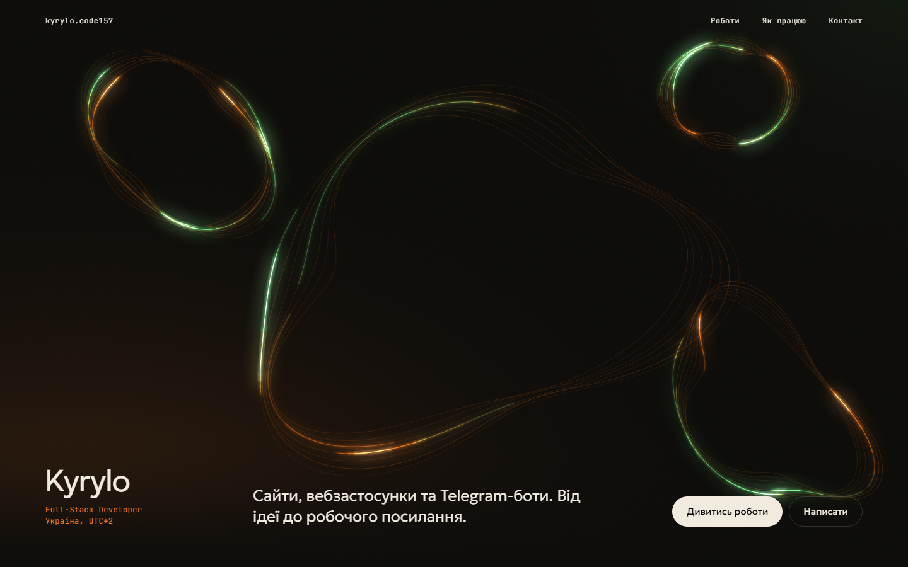
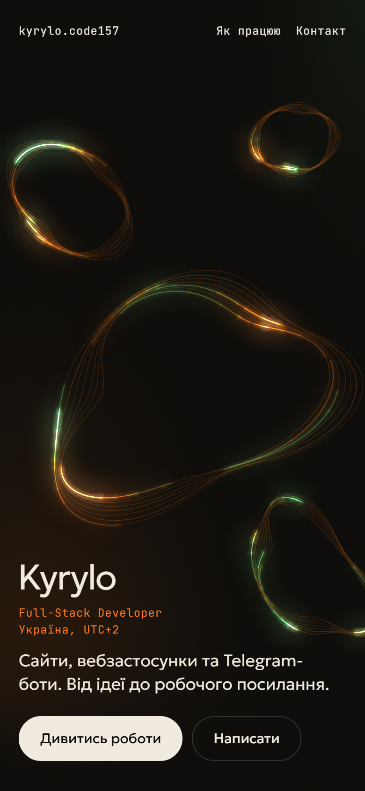
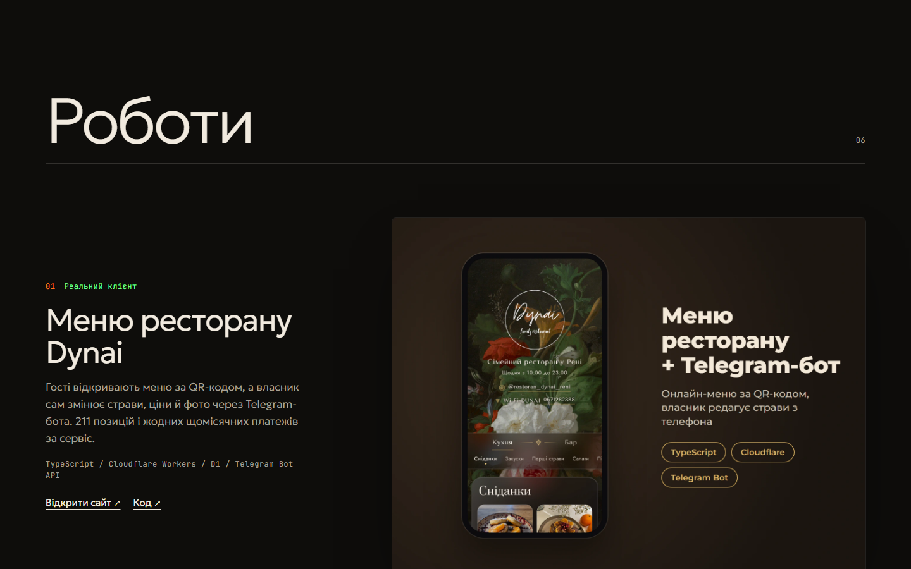

# kyrylo.code — portfolio site

My portfolio: six projects, how I work and how to reach me. A static site in Ukrainian with
a generative "neon lines" hero drawn on canvas.

**Live:** https://kyrylo-code.pages.dev

  
  &nbsp;
  

## Projects

  

## What it does

- Animated hero: neon lines drawn on canvas
- Six projects with laptop and phone mockups, each marked as a real client, a concept or my own project
- Self-hosted fonts, no analytics, no external requests
- Responsive from 320 px phones to ultrawide screens

## Stack

HTML, CSS, JavaScript (canvas), Cloudflare Pages

> Source code is private. Want a site like this for your business? Message me.
